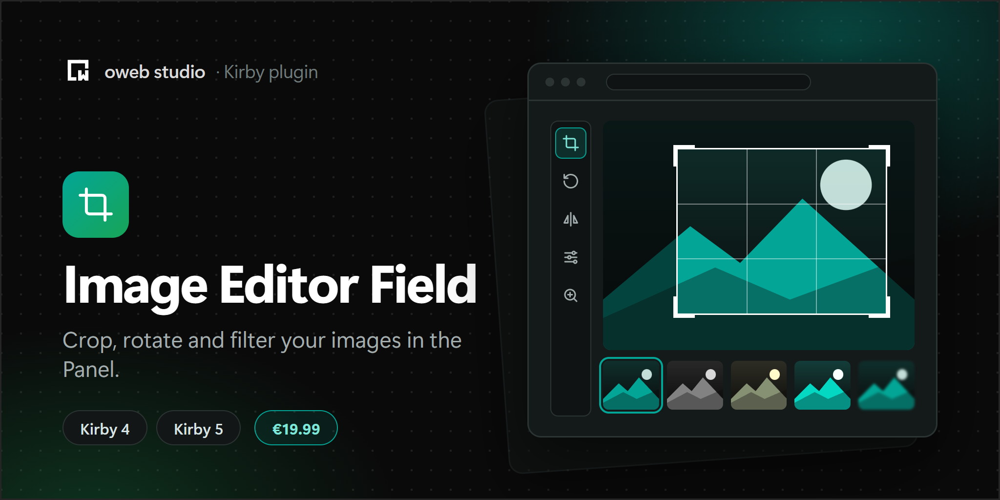

# Kirby Image Editor

[](https://owebstudio.lemonsqueezy.com/checkout/buy/8a06fd59-6e0c-4426-9c1b-95581fd7374a)

Crop, rotate, flip, resize and filter images right in the Kirby Panel, from a field or from the file view.

## Features

- **Crop** freely or with a ratio (original, 1:1, 4:3, 3:2, 16:9 or your own presets), in portrait or landscape. A blueprint can also fix the ratio.
- **Rotate** by 90 degrees and **straighten** by up to 45 degrees. The image zooms in just enough to never leave empty corners.
- **Flip** horizontally and vertically.
- **Resize** to a width and height, with or without keeping the aspect ratio. A maximum size can be set for all saved images.
- **Zoom** with the buttons, the mouse wheel or a pinch, and move the image under the crop area.
- **Filters:** brightness, contrast, saturation, grayscale, sepia and invert. What you see is exactly what gets saved, in every browser.
- **Undo, redo and reset.**
- **Keyboard shortcuts:** `R` and `Shift+R` rotate, `H` and `V` flip, `+`, `-` and `0` zoom, `Ctrl+Z` (`⌘Z`) undoes, `Ctrl+Shift+Z` (`⇧⌘Z`) redoes and `Ctrl+S` (`⌘S`) saves.
- **Save** replaces the original image, **Save as** creates a copy next to it. Both run through Kirby's file actions, so permissions, hooks and the file blueprint's rules apply.
- Uses the Panel's own components, its dark mode and its language (English, German, French and Turkish).

The editor is built on [Cropper.js](https://github.com/fengyuanchen/cropperjs) and adds about 76 kB to the Panel.

## Requirements

- Kirby 6
- PHP 8.3 or newer

For Kirby 4 and 5, use version 1.x of this plugin.

## Installation

1. Download the latest release
2. Unzip downloaded file
3. Copy/paste unzipped folder in your `/site/plugins` folder

Or with Composer:

```
composer require owebstudio/kirby-image-editor
```

## Usage

### Field

The `image-editor` field is a Kirby `filepicker` field (formerly `files`) with an edit button on every image. It accepts all options of the `filepicker` field.

```yaml
fields:
  gallery:
    type: image-editor
    layout: cards
    size: small
```

Only images the editor can open can be picked and uploaded: JPEG, PNG, WebP, GIF and AVIF.

When you save an image as a copy, the copy replaces the original in the field. Save the page to keep this change.

### Edit button in the file view

Add the `image-editor` button to the buttons of a file blueprint to edit any image from its file view:

```yaml
# site/blueprints/files/image.yml
title: Image

buttons:
  - open
  - image-editor
  - settings
```

The button only shows up for images the editor can open, and only for users who may replace the image or create files next to it. After saving, the file view shows the new image. After saving as a copy, the Panel opens the copy.

## Options

| Option | Type | Default | Description |
| --- | --- | --- | --- |
| `menu` | array | `[crop, rotate, flip, resize, filter]` | The tools of the editor. Zoom is always available. |
| `ratios` | array | `[free, original, 1/1, 4/3, 3/2, 16/9]` | Crop ratio presets. Use `free`, `original`, `16/9`, `16:9` or a number like `1.5`. |
| `ratio` | string, number | `null` | A fixed crop ratio, e.g. `16/9`. The ratio presets are hidden then. |
| `quality` | int | `90` | Quality of saved JPEG and WebP images, from 1 to 100. |
| `maxWidth` | int | `null` | Maximum width of saved images in pixels. Larger images are scaled down. |
| `maxHeight` | int | `null` | Maximum height of saved images in pixels. Larger images are scaled down. |

Set them in a field:

```yaml
fields:
  cover:
    type: image-editor
    multiple: false
    ratio: 16/9
    maxWidth: 2400
```

Or for all fields and the file view button in your `config.php`:

```php
return [
    'owebstudio.image-editor' => [
        'menu'     => ['crop', 'rotate', 'resize'],
        'ratios'   => ['free', '1/1', '16/9'],
        'quality'  => 85,
        'maxWidth' => 3000
    ]
];
```

Options in a field win over the config.

### Saved file types

Save keeps the type of the original image. JPEG, PNG and WebP images can be replaced. GIF and AVIF images, and WebP images in browsers that cannot create WebP files, can only be saved as a copy: as WebP, or as PNG where WebP is not available. Animated GIFs are saved as a still image. Transparent areas stay transparent in PNG and WebP images and turn white in JPEG images.

## Upgrading from 1.x

Version 2 replaces the TOAST UI editor with a lean editor of its own. **Drawing, shapes, icons, text and the mask filter are gone.** If you need them, stay on version 1.x with Kirby 4 or 5.

- Requires Kirby 6 and PHP 8.3.
- The plugin is now called `owebstudio/image-editor`, the Composer package `owebstudio/kirby-image-editor` and its folder `site/plugins/kirby-image-editor`. Delete the old `site/plugins/kirby-tui-image-editor` folder when you install the new version.
- Your blueprints and content keep working: the field type is still `image-editor` and stores the same file list.
- `menu` still works. `resize`, `crop`, `flip`, `rotate` and `filter` are kept, the other tools are ignored.
- `cssMaxWidth`, `cssMaxHeight` and `menuBarPosition` are no longer used.
- The config prefix is now `owebstudio.image-editor`. Options under the old `owebstudio.tui-image-editor` prefix are still read.
- Your license key stays active.

## License

Image Editor is a commercial plugin. It is free to use on your local computer and on staging sites. A live site needs
a license key: [buy it](https://owebstudio.lemonsqueezy.com/checkout/buy/8a06fd59-6e0c-4426-9c1b-95581fd7374a) and
activate it in the Panel with the button in the field's or the editor's notice, or in the System view by clicking the
license status of the plugin.

Without a license key, the editor still opens on a live site, but saving the edited image is locked. Your website keeps
working.

[oweb studio Commercial License](LICENSE.md). Versions released under the MIT license stay MIT. The current license is
available [on GitHub](https://github.com/owebstudio/.github/blob/main/LICENSE.md).
